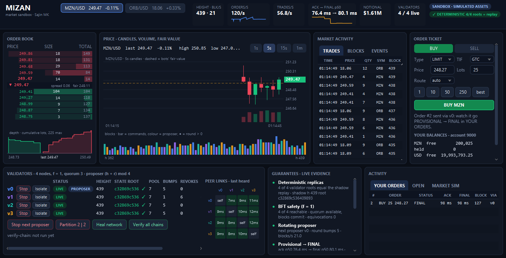
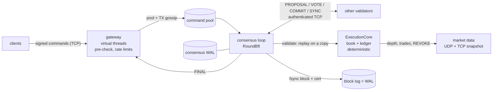

# Mizan

A deterministic limit-order-book exchange on a small BFT chain.
- a single-writer matching engine with an escrowed multi-asset ledger;
- Ed25519-signed commands;
- an fsynced block log as the write-ahead log;
- Tendermint-lite consensus with a rotating proposer.

**Educational project: simulated assets only.**

| | Number | Evidence (re-runnable) |
|---|---|---|
| **Crash recovery** | **200 / 200** kill -9 iterations recovered to the same state root, with every client FINAL found on the chain | [Gate M6](PROGRESS.md#m6) · `./gradlew :mizan-node:recoveryTest -Piter=200` |
| **Consensus faults** | **1,000 seeds × 11 fault scenarios**, no fork, live after every heal; **30-minute chaos run** on 4 validator JVMs (91 kills, 55 partitions, 44 isolations), all 5,985 heights identical | [Gates M7–M9](PROGRESS.md#m9) · `./gradlew :mizan-sim:simSweep -Pseeds=1000` · `./gradlew :mizan-node:chaosTest -Pminutes=30` |
| **Engine latency** | **p99 0.9 µs** per command (signatures off, default G1; 3.5 M commands/s single-threaded, ±25% run to run) on a Ryzen 7 4700U laptop, JDK 21 | [docs/bench/m10.md](docs/bench/m10.md) · `./gradlew :mizan-bench:jmh -Pjmh.includes=ExecuteBench` |

## The sandbox terminal



```sh
./gradlew :mizan-ui:run                    # a whole 4-validator network + market makers, in one window
./gradlew :mizan-ui:run --args="--demo"    # plus a scripted tour: your order, then the proposer is stopped and restarted
```

One window shows the whole running system:
- the order book, depth chart, candles and tape;
- your orders going PROVISIONAL → FINAL with their block height;
- every validator's height and state root, checked against an independent replay;
- the peer links, and the guarantees with live evidence.

From the same window you can stop, restart or isolate any validator, split the network 2 | 2, heal it, run `verify-chain` on every node, and turn the market makers' rate and volatility up or down. See [ADR 0017](docs/adr/0017-ui-sandbox.md).

## Quick start

You need a JDK 17+ to run Gradle. The Java 21 toolchain is downloaded automatically.

```sh
./gradlew build                                   # compile, format, Error Prone, tests, coverage, module graph
./gradlew :mizan-node:installDist                 # launcher: mizan-node/build/install/mizan/bin/mizan
mizan-node/build/install/mizan/bin/mizan cluster --nodes 4 --metrics-port 9100
#   4 validators (rotating proposer); gateways 127.0.0.1:9000..9003; market data UDP :9001
mizan-node/build/install/mizan/bin/mizan load --port 9000 --traders 20 --orders 200 --instruments 2
./gradlew :mizan-ui:run --args="--connect --gateway-port=9000 --md-port=9001"   # plain dashboard for that cluster
mizan-node/build/install/mizan/bin/mizan verify-chain --data cluster-data/v2 --genesis cluster-data/genesis.json
```

The [runbook](docs/runbook.md) covers single-node mode, keys, the faucet, metrics, logs and failure procedures.

## Architecture



- **One writer.** Each validator's committed state is touched by one thread only. The fixed-proposer and single-node modes run a sequencer that executes speculatively and cuts drafts (ADR 0001). The rotating mode executes optimistically only on the proposer, for exactly one proposal (ADR 0015).
- **Finality.** A result is final only when its block has 2f+1 precommits *and* is fsynced locally (ADR 0002). Earlier answers are provisional and can be revoked.
- **Recovery.** Recovery replays the block log from the newest verified snapshot, truncates a torn tail, and refuses mid-log corruption (ADR 0013).

Modules: `core` · `crypto` · `engine` · `store` · `chain` · `net` · `node` · `testkit` · `sim` · `ui` · `bench`. Allowed dependencies are enforced by `./gradlew checkModuleGraph`.

## Determinism rules

These rules are enforced by ArchUnit in `ArchRulesTest`, and each has a planted regression in `scripts/verify-regressions.sh`. The engine never uses:
- a clock, randomness, I/O, threads, logging or floating point;
- iteration over a hash-ordered collection.

In addition:
- Money arithmetic is overflow-checked (`multiplyExact`, with a supply cap of 2^62).
- FIFO order is pinned by order ids inside the state root.
- Every encoding is canonical, which the fuzzer checks: re-encoding a decoded value returns the same bytes.
- The state root (v1 full recompute, or v2 sparse Merkle tree) is in every block header and is re-checked by every validator, by recovery and by `verify-chain`.

## Trade-offs

- **Single writer vs instrument sharding.** One thread executes every instrument. That keeps cross-instrument balances trivially consistent and replay deterministic. It also caps throughput at one core: about 3.5 M commands/s with signatures off, and in practice bounded by Ed25519 verification, which the gateway parallelizes. Sharding by instrument would need cross-shard escrow; it is not built.
- **Deviations from textbook Tendermint** ([protocol](docs/protocol.md)):
  - current-round messages are retransmitted, instead of assuming reliable gossip;
  - messages one height ahead are buffered, and lagging nodes catch up through certificate-checked bulk sync;
  - a restarted node re-sends exactly the vote it already signed;
  - empty blocks keep heights moving;
  - no slashing, and a static validator set.
- **UDP vs TCP.**
  - Market data is UDP unicast with full-state depth packets, so a lost packet is repaired by the next one, with a TCP snapshot on gaps (ADR 0012).
  - Orders and consensus use TCP.
  - Heartbeats are UDP and advisory only.
- **Optimistic execution.** Provisional answers are fast but can be revoked (`REVOKE`); only `FINAL` survives a crash.

## Security

See the [threat model](docs/threat-model.md). In short:
- signatures over `chainId`, nonces burned on rejects, and idempotent retries;
- frame and rate limits, and slow-loris deadlines;
- authenticated validator links and certificate-checked sync;
- no Java serialization or reflection (`SecurityRulesTest`);
- structure-aware fuzzing of every consensus message.

## Performance

- [M3 baseline](docs/bench/baseline.md): the first measurement, before any optimization.
- [M10 optimizations](docs/bench/m10.md): before/after rows. The sparse Merkle state root is 9.6× faster per block at 10k accounts and 70× at 100k. The intrusive O(1)-cancel levels are within noise except on deep queues (+26%). Ed25519 key reuse gave no measurable change. Also: a GC comparison (Parallel and G1 have the best tails) and signature verification with and without the cache (0.5 µs instead of 900 µs).

## Limitations

- **Simulated assets only.** There is no custody, compliance, KYC or real settlement. The admin key mints freely, up to the supply cap.
- **No TLS.** Validator links are authenticated at connect time but not encrypted. Market data and heartbeats are unauthenticated. Run on localhost or a trusted network.
- **Static validator set.** There is no slashing, so equivocation evidence is only logged.
- **One sequencer thread per validator**, with no instrument sharding. Replace-order is cancel-and-new and loses queue priority.
- **Client experience in rotating mode.** A client gets a provisional ack only when its own validator proposes; otherwise the first answer is `FINAL`. Retrying a command whose nonce was already consumed after the result cache rolled over gets no answer (the chaos run saw 10 such orders out of 23,808 attempts).
- **Not human-verified.**
  - The sandbox terminal was checked through screenshots it saves itself (`--screenshot`), plus an end-to-end `SandboxTest`. A person has not yet used it interactively for long.
  - The consensus protocol has had no second-person review (M7-T1).
  - The 5-minute demo recording (M10-T8) and the "a stranger runs the demo" check are not done.
- **Not published.** Artifacts are not on Maven Central or GitHub Packages; that needs credentials.
- Performance numbers come from one laptop. They are measurements, not guarantees.

## Documents

[Spec](implementation-claude-code.md) · [Progress](PROGRESS.md) · [Changelog](CHANGELOG.md) · [Assumptions](docs/assumptions.md) · [Protocol](docs/protocol.md) · [Threat model](docs/threat-model.md) · [Runbook](docs/runbook.md) · ADRs:
[0001 single writer](docs/adr/0001-single-writer.md) ·
[0002 block log is the WAL](docs/adr/0002-block-log-is-wal.md) ·
[0003 nonce idempotency](docs/adr/0003-nonce-idempotency.md) ·
[0004 name](docs/adr/0004-project-name.md) ·
[0005 toolchain](docs/adr/0005-toolchain-versions.md) ·
[0006 testkit edges](docs/adr/0006-test-scope-testkit-edges.md) ·
[0007 core types](docs/adr/0007-core-type-placement.md) ·
[0008 engine semantics](docs/adr/0008-engine-semantics-clarifications.md) ·
[0009 test signing](docs/adr/0009-test-signing-and-arch-scans.md) ·
[0010 sequencer batching](docs/adr/0010-sequencer-batching.md) ·
[0011 gateway](docs/adr/0011-gateway-design.md) ·
[0012 market data](docs/adr/0012-market-data.md) ·
[0013 persistence](docs/adr/0013-persistence-and-recovery.md) ·
[0014 BFT](docs/adr/0014-bft-implementation.md) ·
[0015 rotation and sync](docs/adr/0015-rotation-forwarding-sync.md) ·
[0016 state root v2](docs/adr/0016-state-root-v2.md) ·
[0017 sandbox terminal](docs/adr/0017-ui-sandbox.md)
